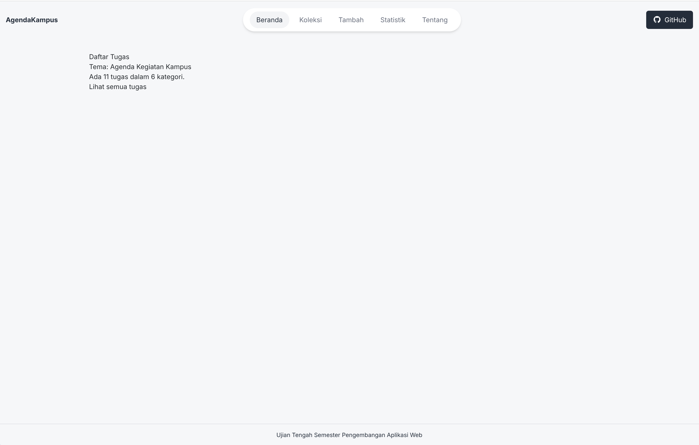

# Judul Aplikasi : Manajemen Agenda Kampus

## Identitas Mahasiswa
- Nama: Gede Valendra
- NIM: 124140142
- Kelas: RB
- Tema: Agenda Kegiatan Kampus
- Deployment: https://gedevalendra.github.io/uts-paw/

## Tangkapan Layar Beranda


## Fitur

- Melihat Jadwal Agenda Kegiatan Kampus
- Menambahkan Jadwal Agenda Kegiatan Kampus
- Menghapus Jadwal Agenda Kegiatan Kampus
- Melihat Detail Jadwal Agenda Kegiatan Kampus


## Menjalankan secara lokal

1. Lakukan Clone Pada Project Ini
```bash
git clone https://github.com/gedevalendra/uts-paw.git
```
2. Setelah Berhasil Di Clone Buka Folder App pada project uts-paw
```bash
cd app
```
3. Jalankan perintah dibawha ini untuk menginstall node_modules
```bash
npm install
```
4. Untuk Menjalankan App Cukup Gunakan Perintah Dibawah Ini.
```bash
npm run dev
```
## Konsep React yang dipakai

- Link
- Components
- Context
- Hooks
- Pages
